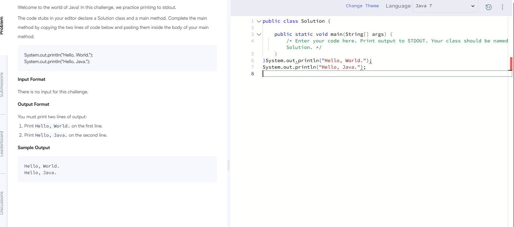

# Практична робота №0 — Налаштування середовища

## Інформація про студента
- Ім'я: Роман
- GitHub: https://github.com/Roman18-ai
- Репозиторій: https://github.com/Roman18-ai/aop-practice-0

## Версії інструментів

### Java
Команда: `java -version`

Результат: Java 25.0.5

### Java Compiler
Команда: `javac -version`

Результат: 25.0.5

### Git
Команда: `git --version`

Результат: 2.56.0

## Налаштування Git
Команда: `git config --global --list`

- user.name: Roman18-ai
- user.email: romanchiks333@gmail.com

## Перевірка SSH
Команда: `ssh -T git@github.com`

Результат: успішна автентифікація GitHub для користувача Roman18-ai.

## Перевірка Java-програми
Команди:
- `javac Main.java`
- `java Main`

Результат:
`Hello, World!`

## Claude Code
Claude Code було встановлено, але для авторизації потрібен платний доступ. Використання платних послуг не здійснювалося.

## Проблеми та їх вирішення
- Пункт Java Class був відсутній у меню IntelliJ IDEA. Створено файл `Main.java` вручну.
- Програму успішно скомпільовано та запущено через термінал.

## Скріншоти
До звіту потрібно додати скріншоти результатів команд і виконання програми.
### HackerRank — Welcome to Java!

